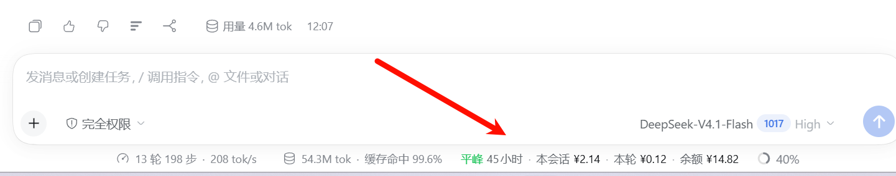

# DS时段费用参考

[](https://github.com/codeora-Kayson/dsh-peak-meter/actions/workflows/check.yml)

一个 [DeepSeek Harness](https://github.com/deepseek-ai/deepseek-harness)（DSH）插件：在输入框下方的统计条里常驻显示 **DeepSeek 当前是平峰还是高峰、距切换还有多久、本会话与本轮的费用、账户余额**；点一下展开明细卡，里面还有官方价目表和时段进度。

- 包名：`dsh-peak-meter`
- 仓库：`codeora-Kayson/dsh-peak-meter`
- GitHub topic：`dsh-plugin`



---

## 功能

| | |
| --- | --- |
| **时段徽标** | `平峰`（绿）/ `高峰`（琥珀），并显示距下次切换还有多少小时 |
| **本会话费用** | 整段会话的 token × 当前时段官方单价 |
| **本轮费用** | 最近一个已完成 Turn 的精确用量 × **该轮发生时段**的单价 |
| **账户余额** | DeepSeek 账户的充值 + 赠送余额，未登录时显示状态而不是消失 |
| **明细卡** | 点击统计条展开：费用、余额、时段进度条、官方价目表、官方价格页链接 |
| **零配置** | 装完即用；不写配置文件、不申请任何凭据 |

## 安装

### 桌面版（推荐）

**设置 → 插件** → 在安装框粘贴仓库地址 `https://github.com/codeora-Kayson/dsh-peak-meter` → 安装 → 刷新页面。

> 桌面版（`desktop` 配置档）由 Electron 独占，命令行会被拒绝，只能走界面安装。

### 命令行

```sh
dsh plugin --profile web add github:codeora-Kayson/dsh-peak-meter
```

npm 包名为 `dsh-peak-meter`（暂未发布到 npm）；发布后可用包名安装：

```sh
dsh plugin --profile web add dsh-peak-meter
```

### 移除

**设置 → 插件** → 找到「DS时段费用参考」→ 卸载 → 刷新页面。

## 界面

### 统计条

```
— tok/s   缓存 23%   ◯ 上下文 1%   平峰 45小时 · 本会话 ¥0.01 · 本轮 ¥0.01 · 余额 ¥13.57
└────────── Harness 自带 ─────────┘  └────────────── 本插件 ──────────────┘
```

### 明细卡

点击整格展开，再点、按 `Esc` 或点卡片外部收起：

```
费用参考                                  ✕
本会话              本轮
¥1.74              ¥0.20

● 平峰时段  5 折                  还有 39 小时 43 分
[███████████░░░░░░░░░░░░░░░░░░]
10月26日 09:00 进入高峰时段
──────────────────────────────────────────
账户余额  ¥13.57              去充值  刷新
充值 ¥10.26 · 赠送 ¥3.31 · 更新于 17:17
──────────────────────────────────────────
元 / 百万 tokens（划线为高峰价）
模型                   缓存命中  缓存未命中      输出
DeepSeek-V4.1-Flash     0.02 0.04    1 2          4 8
DeepSeek-V4-Pro         0.15 0.3    4.5 9      13.5 27
──────────────────────────────────────────
高峰：工作日 09:00–12:00、14:00–18:00（北京时间）
核对 2026-10-24                          官方价目
```

进度条表示**当前时段已经走过的比例**，打开卡片时按秒推进。

## 计费口径

### 时段

北京时间（UTC+8，无夏令时）：

- **高峰**：周一至周五 `09:00–12:00`、`14:00–18:00`，且不是中国法定节假日
- **平峰**：其余所有时间，包括周末与法定节假日全天；单价为高峰价的 **50%**

内置 2026 年法定节假日表（国办发明电〔2025〕7号）。未覆盖的年份按普通工作日判断，跨年前请在 `client.js` 的 `HOLIDAY_RANGES` 补表。

规则来源：[DeepSeek 官方价格页](https://api-docs.deepseek.com/zh-cn/quick_start/pricing)。

### 价目表

单位：元 / 百万 tokens（`TIERS` 常量，费用估算与表格共用同一份数据）。

| 模型 | 缓存命中 | 缓存未命中 | 输出 |
| --- | --- | --- | --- |
| DeepSeek-V4.1-Flash | 0.02 / 0.04 | 1 / 2 | 4 / 8 |
| DeepSeek-V4-Pro | 0.15 / 0.30 | 4.5 / 9 | 13.5 / 27 |

每格为 `平峰 高峰`，界面上高峰价带删除线。

### 费用怎么算

```
费用 = (缓存命中 token × 命中价 + 未命中输入 token × 未命中价 + 输出 token × 输出价) / 1,000,000
```

- **本会话**：读取会话投影 `tokenUsage` 的四个桶（`cacheReadTokens` / `uncachedInputTokens` / `cacheWriteTokens` / `outputTokens`），整段按**当前时段**单价折算。
  投影不带时间维，所以跨峰谷的历史用量会按当前单价计，属于估算。
- **本轮**：读取最新 Turn 的 `turn-tail` 节点里的精确用量，按**该轮发生时刻**的时段计价。
- 缓存命中与未命中价差 50 倍，所以四个桶必须分开算，不能用一个均价糊过去。

## 余额

只作用于 **DeepSeek 账户**，免费/第三方渠道没有可读余额。

- 优先走客户端 Remote：`ctx.remote.account.getBalance`（先 `getState` 判断登录态）
- 若客户端未挂载该命名空间，回退到 Host 路由 `GET /__dsh-peak-meter/balance`（**仅接受 loopback 请求**，由 `ctx.deepseekAccount` 提供余额）
- 两种方式都不接触、不存储、不转发任何密钥或 token
- 打开卡片会刷新一次；之后每 5 分钟自动刷新；单次调用 8 秒超时
- 读不到时**不隐藏**而是显示状态（`未登录` / `—` / `不可用`），悬停可看具体原因

## 隐私与权限

- 除账户余额经由 DSH 自身的账户服务读取外，插件**不发起任何外部网络请求**
- 不采集遥测、不上传会话内容、不写用户目录
- Host 路由只监听 loopback，且只返回余额数字与官方链接

## 兼容性

| 项 | 值 |
| --- | --- |
| DSH | 0.2.1-rc.2（实测） |
| 平台 | desktop / web |
| Node | 随 DSH 提供，无额外要求 |
| 依赖 | 无运行时依赖，无需构建 |

## 已知限制

1. **费用是估算**：本会话按当前时段单价折算；要逐请求精确计价需要 Host 侧按事件时间折叠。
2. **本轮依赖 Chat 视图已物化**：切到轨迹视图等 Chat 未激活时，本轮金额暂时隐藏。
3. **不识别渠道**：模型档位/provider 不在标准 props 里；走免费或第三方渠道时，金额只是"按官方牌价的参考值"。
4. 未计入网页搜索/抓取的调用费。
5. 价目是静态快照（当前核对日期 2026-10-24），官网调价后需更新 `TIERS` 与 `PRICING_UPDATED`。

## 开发

```
client.js           浏览器半身：时段判定、价目、费用、余额、明细卡、i18n
index.js            Host 半身：注册 loopback 余额路由
cordis.patch.yml    bundle patch（一行 Host 行 peak-meter）
locale/{zh,en}.json 插件列表里的显示名与描述
icon.svg            插件图标
scripts/market.mjs  生成插件市场索引 market.json
```

本地开发时用目录软链安装，改完刷新页面即可：

```sh
dsh plugin --profile <profile> add link:<本目录绝对路径>
```

## License

[MIT](LICENSE)
